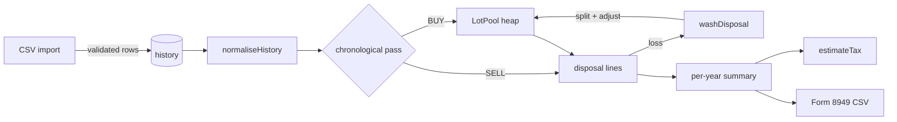

# BitTax: Cold Storage Audit Tool (Desktop)

**BitTax** is a privacy-focused, local-first desktop application that audits self-custodied
cryptocurrency holdings and produces a Form 8949 style capital gains report.

> [!WARNING]
> **Never paste spending material into this or any audit tool.**
> BitTax needs only watch-only data. It actively detects and refuses extended private keys
> (`xprv`/`yprv`/`zprv`), WIF keys, raw 256-bit keys and BIP39 seed phrases. If you have
> already pasted one somewhere, treat it as compromised and move the funds.

<!-- Two separate GitHub alerts; the comment keeps them from merging. -->

> [!NOTE]
> This is an estimation and record-keeping tool, not tax advice, and not a filing service.
> Consult a CPA before you file.

## What it does

### Local and private, enforced rather than promised

- **Offline by construction.** The Electron session cancels every outbound request that is
  not the app's own `app://` scheme, and the page's CSP sets `connect-src 'none'`. There is
  no telemetry, no account, no sync.
- **Hardened renderer.** `contextIsolation`, `sandbox`, no Node integration, a strict
  Content-Security-Policy served as a real header, navigation, redirects, popups, downloads
  and permissions denied, DevTools excluded from packaged builds. Every IPC handler refuses
  calls that do not come from the app's own top-level page.
- **Watch-only.** Extended *public* keys are parsed and validated; private material is
  refused at the input boundary — and in labels and notes — and never enters state, logs or
  persistence.
- **Encrypted at rest.** History, labels, freezes, notes and settings are stored through the
  OS keystore (DPAPI on Windows, Keychain on macOS, libsecret or KWallet on Linux). On a
  Linux desktop with no keyring, Chromium silently falls back to a key compiled into the
  app; BitTax detects that and declines to write rather than store a blob anyone can
  decrypt. Saves are serialised, fsynced and atomically renamed. The demo profile never
  writes.

### Capital gains

- **Cost basis methods:** FIFO (IRS default), LIFO, HIFO, over a priority queue: a
  100,000-row history audits in about a second per method.
- **Per tax year.** Disposals, the Schedule D figures, the estimate and the Form 8949 export
  are all scoped to the selected year.
- **Short and long term** by calendar day, per Pub 544 and Rev. Rul. 66-7 (a 29 February
  purchase is long term from 1 March of the following year).
- **Fees** are folded into basis on acquisition and netted from proceeds on disposal.
- **Wash sale treatment** (optional, on by default), applied in chronological order at the
  moment each loss is realised: replacements are matched in acquisition order, only the
  replacing units are adjusted (split into their own tranche), each unit replaces once,
  units from the same purchase and units already sold are excluded, and the replacement's
  holding period is tacked by the *days* the washed position was held (§1223(3)). Losses on
  replacement lots are tested in turn, and HIFO ranks by adjusted basis.
- **Exact arithmetic.** Every amount is an integer of base units — satoshi, wei, cent —
  held as a BigInt. No figure on a tax document is the result of binary floating point.

### Tax estimate

- Federal ordinary brackets and 0/15/20% long-term rates stacked per the Qualified Dividends
  and Capital Gain Tax Worksheet, plus the 3.8% NIIT.
- Tables for **2024, 2025 and 2026**, each pinned figure-by-figure by a test against its
  revenue procedure (Rev. Proc. 2023-34, 2024-40, 2025-32).
- Schedule D netting with the $3,000 loss limit ($1,500 married filing separately), and
  **carryovers in and out by character** (short / long term).

### Address derivation

- **Watch-only expansion.** An account-level `xpub`/`ypub`/`zpub` becomes the addresses your
  wallet would use — receive and change chains, any index range. Nothing derived here can spend.
- **Self-tested before use.** secp256k1 arithmetic is checked against group identities and
  an independent affine ladder, bech32 against BIP173, Base58Check against the genesis
  address, and BIP32 CKDpub against BIP32 test vector 1. The test suite also pins the BIP84
  reference addresses. Any failure disables derivation instead of producing addresses.
- **Fast.** Jacobian-coordinate scalar multiplication derives 200 addresses in ~0.4 s.

### Coin control

- **UTXO manager.** Every open lot with its acquisition date, cost basis, value and any
  wash-sale adjustment it carries.
- **Freeze** a purchase to hold it back from cost-basis selection. If a sale exhausts
  everything else and has to reach a frozen lot, you are told which one and when.
- **Label** lots and annotate transactions. Both are saved encrypted, keyed to the purchase
  rather than to its position in a file.

### Import and export

- **Import** CSV exports from wallets and exchanges, including Coinbase's format with its
  preamble. Columns are matched across dialects; dates are parsed deterministically (zone-less
  timestamps are UTC); every value is validated per row and failures are reported by line.
- **Transfers are never guessed at.** Send / Receive / Deposit / Withdrawal rows are skipped
  and listed, because moving coins to your own cold storage is not a sale. Swaps are flagged
  for manual entry. Staking and other income becomes a lot at market value, with a notice
  that its value is ordinary income.
- **Imports merge.** Re-importing a file, or overlapping exports, never doubles a position.
- **Export** a per-year Form 8949 layout (with the `W` adjustment code and column (g)
  amount) or a full working paper including your labels and notes. Both are RFC 4180
  correct and neutralise spreadsheet formula injection.

## Install and run

```bash
npm install          # the desktop shell (electron, electron-builder, playwright-core)
npm run electron     # run the desktop app
npm run electron:dev # same, with DevTools (never in packaged builds)
npm run dist         # build a Windows installer into dist/
```

## Tests

The audit core and the main-process modules have **no runtime dependencies**, so the main
suite needs no install:

```bash
npm run check   # syntax check of every source file, the unit suite, and the smoke verifiers
npm test        # the unit suite alone
```

`npm test` covers money arithmetic, lot selection, wash sales, holding periods, tax brackets
(pinned to the published tables), CSV import and export, Base58Check, SHA-256 (FIPS 180-4),
secp256k1, bech32 (BIP173), BIP32 CKDpub (test vector 1), BIP84 reference addresses, secret
detection, the IPC and protocol boundaries, and the encrypted vault's file handling.

The desktop smoke test boots the real app and drives it through the UI — demo audit,
per-year figures, coin control, secret refusal, derivation, CSV import and the network kill
switch:

```bash
npm install
xvfb-run -a npm run smoke   # or just `npm run smoke` on a desktop
```

CI runs `npm run check` on Node 20, 22 and 24, then the desktop smoke test.

## Trying it out

1. `npm run electron`
2. Click **Running a test? Load demo profile** — a banner marks every figure as sample data.
3. Switch the **Tax year** between 2023 and 2024; compare **FIFO / LIFO / HIFO**. The demo
   contains a wash sale, a long-term disposal, a
   CoinJoin-flagged sale and a Lightning channel open.
4. Freeze a lot in **UTXO manager** and see the next sale draw elsewhere.
5. Check **Notices** for engine warnings.

To audit real holdings, use **Import history (CSV)** and enter a mark price per asset.

## Architecture

```text
main.js              Electron main: window, session lockdown, navigation guards
preload.cjs          The entire privileged surface exposed to the renderer
src/main/            Main-process only: app:// protocol, IPC validation, vault, derivation
src/core/            The audit engine. Pure, dependency-free, shared by every surface
renderer/            Desktop UI. No innerHTML on user data, no inline handlers
scripts/             Test runner, syntax check, smoke verifiers, desktop smoke test
```



`src/core` is the single implementation of every calculation. The main process imports the
same asset, method, filing-status and secret-detection definitions to validate IPC, so the
boundary cannot drift from the engine.

## Known limitations

- **Federal only.** No state tax, AMT, credits or phase-outs. `Other taxable income` is taxable
  income after deductions, and stands in for MAGI in the NIIT calculation.
- **Wash sale applicability.** Section 1091 is written for "stocks or securities"; digital
  assets are generally treated as property, so this treatment is conservative rather than
  certain. It is a visible toggle — decide with your preparer.
- **Dates are UTC.** A trade's tax date is its UTC calendar date. Trades made late in the
  evening in the Americas around 31 December can land in the next year; check those by hand.
- **Transfers are skipped, not reconciled.** BitTax does not match a Send on one exchange to
  a Receive in your wallet; basis follows the lots you import.
- **Swaps need two rows.** A crypto-to-crypto conversion must be entered as a SELL and a BUY.
- **No chain lookup.** Addresses can be derived, but nothing fetches their history.
- **Multisig keys (`Ypub`/`Zpub`) cannot be expanded.** An address needs every cosigner's key.
- **Linux without a keyring** cannot save; the data stays in memory for the session.

## Roadmap

- [ ] **History fetching.** An Electrum or Esplora client behind an explicit, per-session
      network opt-in, to turn derived addresses into a transaction history.
- [ ] **Transfer reconciliation** across imported sources.
- [ ] **Two-leg swap import** for exchanges that export conversions as one row.
- [ ] **PSBT construction** from the selected, unfrozen UTXO set.

***

**Disclaimer**: This software is for educational and informational purposes only. It does not
constitute tax, legal or financial advice. Verify every figure before filing.
